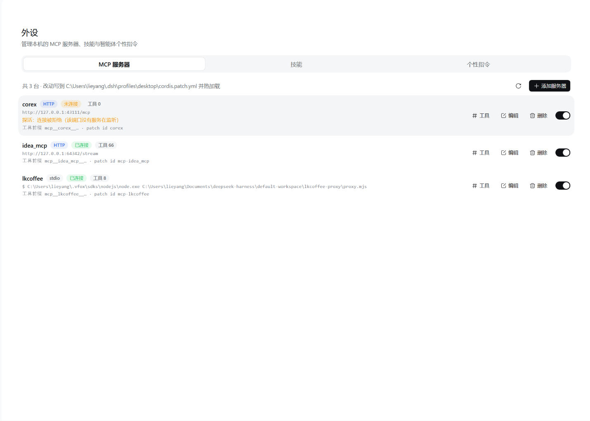

# dsh-peripherals

把 **「外设」面板** 做进 [DeepSeek Harness（DSH）](https://github.com/deepseek-ai) 的侧栏，用一页管理 **MCP 服务器**、**技能（Skill）** 与 **AGENTS.md 个性指令**。

[](./LICENSE)
[](./cordis.patch.yml)

> A third-party DSH plugin that adds a "Peripherals" sidebar panel for managing MCP servers, skills and AGENTS.md instruction files — all changes are written to the places DSH itself reads, so no restart is needed for config edits.

---

## 截图



> 「外设 → MCP 服务器」：每行显示连接状态、已注册工具数，可直接查看工具、编辑、删除或启停。

## 功能特性

侧栏「插件」下方多出一个图标（`sidebar.panellist`，order 1），点开在主栏整页渲染，内部用分段 tab 切换三页：

| 页面 | 能力 |
|---|---|
| **MCP 服务器** | 列出当前生效的服务器，支持新增 / 编辑 / 删除 / **启用停用**；每行显示连接状态与**已注册工具数**，可查看工具名与描述 |
| **技能** | 扫描 `~/.dsh/skills`、`~/.agents/skills`（有项目根时再加项目内 `.dsh/skills`、`.agents/skills`），查看 / 新建 / 编辑 / 删除 / 在文件管理器中打开，支持**从 cc-switch 同步**（软连接或复制） |
| **个性指令** | 按 DSH 真实加载顺序列出 `AGENTS.md` / `CLAUDE.md` / `AGENTS.local.md` / `CLAUDE.local.md`，就地新建 / 编辑 / 删除 |

几个实现上的取舍：

- **MCP 改动即时生效**：直接写当前 profile 的 `cordis.patch.yml`，由 DSH 的 HMR 热加载，不用重启应用；每次写入前都会留一份带时间戳的备份。
- **连接状态是真实探活**：HTTP 服务器发一次 MCP `initialize` 握手（2 秒超时）；stdio 服务器看工具是否注册上。探不通显示黄色「未连接」并给出原因（如「连接被拒绝（该端口没有服务在监听）」），探不准显示灰色「未验证」。
- **MCP 启停走官方通道**：调用 `ctx.remote.pluginManager.setPluginEnabled(entryId, enabled)`，由官方插件管理器把 `disabled` 写进 profile patch 并触发重载，本插件不改 YAML、也不需要额外权限。
- **删除是可逆的**：技能与指令文件移入 `~/.dsh/dsh-peripherals/trash/<时间戳>/`，软连接只摘链接本身。

## 安装

本插件遵循 DSH 官方插件规范（host 半侧 + client 半侧），不改动 DSH 应用本身。下面以 `desktop` profile 为例，换成你实际使用的 profile 名即可。

### 方式一：从 npm 安装

```bash
dsh plugin --profile desktop add dsh-peripherals
```

### 方式二：从 GitHub 源码安装

```bash
dsh plugin --profile desktop add github:lieyang/dsh-peripherals
```

### 方式三：本地源码（开发用）

```bash
git clone https://github.com/lieyang/dsh-peripherals.git
dsh plugin --profile desktop add "file:C:/path/to/dsh-peripherals"
```

### 确认已启用

上面的命令只负责把包装进 profile；还要确认 `~/.dsh/profiles/desktop/package.json` 的 bundles 清单里有它（没有就补一行）：

```jsonc
{
  "dependencies": {
    "dsh-peripherals": "file:../../plugins/dsh-peripherals"
  },
  "dsh": {
    "profile": {
      "bundles": ["dsh-peripherals"]
    }
  }
}
```

装好后重启一次 DSH，浏览器刷新页面，侧栏「插件」下方就会出现「外设」图标。

### 卸载

```bash
dsh plugin --profile desktop remove dsh-peripherals
```

再从 `dsh.profile.bundles` 里删掉同名条目即可。

## 配置

在 profile patch 里给条目加 `config`：

```yaml
- id: dsh-peripherals
  config:
    # cc-switch 技能同步的来源目录，默认 ~/.cc-switch/skills
    syncSourceDir: 'D:\path\to\skills'
    # 同步方式：link（软连接，默认）或 copy（复制文件）
    syncMode: link
```

| 配置项 | 类型 | 默认值 | 说明 |
|---|---|---|---|
| `syncSourceDir` | string | `~/.cc-switch/skills` | 技能同步的来源目录 |
| `syncMode` | `link` \| `copy` | `link` | 默认同步方式，弹窗里仍可临时切换 |

## 目录结构

| 文件 | 职责 |
|---|---|
| `lib/index.js` | 宿主入口：等 `webServer` 就绪后挂载全部路由 |
| `lib/mcp.js` | MCP 服务器：从运行中 loader 读，经 `configEditor` 改，按文本增删 patch 行 |
| `lib/health.js` | MCP 探活：HTTP 发 `initialize` 握手、stdio 看工具注册，产出每行的 `health` |
| `lib/skills.js` | 技能：扫描根目录、解析 frontmatter、读写 / 回收站删除、cc-switch 同步 |
| `lib/agents.js` | AGENTS.md：定位全局与工作区指令文件槽位，读写 / 回收站删除 |
| `lib/yaml.js` | profile patch 的最小文本编辑（保注释、保 `!!js`、写前备份） |
| `lib/util.js` | 同源校验、JSON 收发、`!!js` 值编码等小工具 |
| `client/client.js` | 浏览器半侧：注册 `main`（key = `local-tools`）整页与 `sidebar.panellist` 图标 |
| `cordis.patch.yml` | bundle patch：把插件条目插入 profile 加载树 |

客户端服务依赖：`slots`（注册面板）、`remote` + `remote.pluginManager`（官方插件启停）。

面板 id 固定为 `local-tools`，任何客户端代码都能用 `ctx.layout.selectPanel('local-tools')` 路由过来，`ctx.layout.panelInfo` 也能读到当前选中项。

## HTTP 路由

全部挂在同源路径下，POST 只接受本机回环来源；前缀 `/dsh-mcp-skill` 是插件的内部命名空间（与包名无关，保持稳定）：

| 方法与路径 | 说明 |
|---|---|
| `GET /dsh-mcp-skill/mcp` | 列出 MCP 服务器、profile patch 路径，并附带每台的实时探活结果 `health` |
| `POST /dsh-mcp-skill/mcp/save` | `{ id?, config }`：有 `id` 走覆盖写入，无 `id` 追加 insert 块 |
| `POST /dsh-mcp-skill/mcp/delete` | `{ id }`：从 patch 里摘掉该条目（含覆盖行） |
| `GET /dsh-mcp-skill/skills` | 列出技能根目录与技能 |
| `GET /dsh-mcp-skill/skills/read?path=` | 读一个 `SKILL.md` |
| `POST /dsh-mcp-skill/skills/save` | `{ path?, name?, content }`：覆盖或新建 |
| `POST /dsh-mcp-skill/skills/delete` | `{ path }`：移入回收站 |
| `POST /dsh-mcp-skill/skills/reveal` | `{ path }`：在文件管理器中定位 |
| `POST /dsh-mcp-skill/skills/sync` | `{ dryRun?, mode? }`：`dryRun: true` 只返回同步计划，`mode` 取 `link`（默认）或 `copy` |
| `GET /dsh-mcp-skill/agents` | 列出全局与各工作区的指令文件槽位、渲染预算 |
| `GET /dsh-mcp-skill/agents/read?path=` | 读一个指令文件 |
| `POST /dsh-mcp-skill/agents/save` | `{ path, content }`：新建或覆盖 |
| `POST /dsh-mcp-skill/agents/delete` | `{ path }`：移入回收站 |
| `POST /dsh-mcp-skill/agents/reveal` | `{ path }`：在文件管理器中定位 |

「打开目录」按钮不新增宿主路由，按顺序尝试两条既有通道：

1. DSH 官方的 `POST /open-in-app/open`（`{ app, path }`，`app` 按平台取 `finder` / `explorer` / `filemanager`）——真正在文件管理器里打开该目录；
2. 失败时退回本插件的 `/skills/reveal`，在文件管理器里定位该目录。

## 安全边界

- profile patch 的每次写入都先在 `~/.dsh/dsh-peripherals/backups/` 留一份带时间戳的备份。
- 删除技能不直接抹掉，而是移到 `~/.dsh/dsh-peripherals/trash/<时间戳>/`；删软连接只摘链接。
- 技能文件的读写被限制在技能根目录之内；写入只允许 `.md`。
- 指令文件的写操作只认模型里的槽位（全局那一个文件 + 各工作区链上的候选文件），其它路径一律 403。
- 同步的源与目标互相嵌套时直接拒绝；软连接目标必须是已存在的目录。
- MCP 配置里的 `!!js` 表达式在表单中以 `!!js <表达式>` 呈现，保存时原样还原，不会被求值。

## 个性指令（AGENTS.md）

页面按 `@deepseek-ai/dsh-agent-instructions` 的真实规则排布：

- **全局**：`$DSH_HOME/AGENTS.md`（`~/.dsh/AGENTS.md`），对所有会话生效；
- **工作区**：从项目根（默认以 `.git` 为标记）一路到工作目录，每个目录的候选文件依次是 `AGENTS.md`、`CLAUDE.md`（基础）→ `AGENTS.local.md`、`CLAUDE.local.md`（本地 overlay）；
- 布局里只保留「项目根 / 工作目录 / 含有文件的目录」，祖先空目录不占位置；
- 标题栏下方显示真实渲染预算（读 `agent-instructions` 条目的 `maxBytes`，读不到用 64 KB）与单文件上限（1 MB）。

保存后从**下一次请求**开始生效；同一目录里与 `AGENTS.md` 内容相同的 `CLAUDE.md` 只会加载一次。

## 从 cc-switch 同步技能

技能页标题下方有一行「同步来源：`<dir>`」和一个**同步**按钮：点开后先展示计划，确认后才执行。

**同步只在按下「同步」时执行**：打开弹窗只做一次只读的 `dryRun` 预览，不会写盘；没有随页面打开、随保存或随启动的自动同步。

| 方式 | 行为 | 适合 |
|---|---|---|
| **软连接**（默认） | 在 `~/.dsh/skills/<name>` 建一个指向源目录的链接（Windows 用目录联接 `junction`，无需管理员权限） | 省空间；源目录改动立刻生效 |
| **复制文件** | 整棵目录复制进 `~/.dsh/skills` | 两边各自独立 |

计划里的状态：`新增`（目标没有）、`转软连接`（目标在、但不是指向源的链接，将被替换）、`覆盖`（复制模式下内容不同或目标是链接）、`已是最新`（跳过）。

其它约定：

- 目标固定为用户技能根 `$DSH_HOME/skills`（`~/.dsh/skills`）；
- 目录 bundle 整棵处理（含 `references/`、`scripts/`、`assets/`），平铺 `<name>.md` 也支持；
- 复制模式下「是否需要更新」按**相对路径 + 文件大小**的内容指纹判断，与时间戳无关；
- 复制走「临时目录 → 整体替换」，中途失败不会留下半个技能目录；
- 只做单向同步：**不会删除** DSH 里源目录中已不存在的技能。

## 让 DSH 真正发现这些技能（重要）

页面自己扫磁盘，所以页面上能看到技能，**不代表 DSH 的 `/` 菜单和模型技能目录也能看到**。

部分 profile（例如 `@deepseek-ai/dsh-web-app` 自带的 patch）会关掉基础行 `skill-filesystem`，改由 Agent 预设自己挂载同名条目；如果当前预设没有挂，技能注册表就是空的 —— `/` 菜单与模型目录全空。修复只需一次：在插件页里打开 `include:skill-filesystem`（或在 profile patch 里把该行的 `disabled` 去掉）。

还有两个容易踩的点：

- **`/` 菜单的技能目录按 session 缓存**：第一次取到空数组后不会自己重取，只有切换 Agent 预设、连接重置或刷新页面才会重新拉；
- **必须在已打开的会话里输入**：首页「新建会话」的输入框没有 session id，客户端会直接拒绝取目录，那一栏不会出技能。

软连接能被 DSH 发现：本地技能根走的是 Node 枚举，`nodeEntryKind()` 会把链接 stat 成目录，因此默认就用软连接 —— 不占磁盘，cc-switch 改了立刻生效。

## 已知限制

- 项目级技能根目录只在宿主进程的工作目录能找到 `.git` 祖先时才出现（桌面端宿主通常跑在 profile 目录下，因此默认只有两个用户级根目录）。
- MCP 条目的 `serverName` 必须唯一；改名为已存在的名字会被拒绝。
- stdio 服务器无法真探活：子进程由 DSH 客户端托管，页面不重复拉起（避免副作用），因此这类服务器最多显示「未验证」。
- `lib/*.js` 的改动要等 DSH 下次启动才生效（宿主模块按 URL 缓存在进程里，HMR 只重载配置与客户端 bundle）；`client/client.js` 的改动手动刷新页面即可。

## 设计说明

页面视觉对齐 DSH 原生「插件」页：20px 页标题 + 13px 说明、分段 tab、14px 行标题 + 13px 描述、0.5px 细线分隔的列表行（不用卡片盒子），空态是纯文字；页头带 `data-window-drag` 可拖动窗口。

表单控件沿用 DSH 自己的设计语言：输入框取设置页同款几何（34px 高、0.5px 描边、`radius-md`、13px 字号、聚焦蓝色描边）；卡片 / 分隔线用中性半透明面（浅色主题下 `bg-layer-*` 全是白色，用层色做卡片会看不见）；按钮 / 弹窗 / 标签 / 分段 tab 直接复用 `@deepseek-ai/dsh-client-ui-primitives`。

> 为什么 DSH 原生的「设置」按钮没有一起搬进侧栏面板列表：面板列表的每一项由侧栏渲染成一个按钮、点击固定调用 `ctx.layout.selectPanel(id)`，而「设置」是宿主自己的**弹窗**，客户端服务里没有打开它的公开 API；把它的触发控件搬过去就得替换宿主整个设置面板，而内置分区（账户 / 通用 / 模型 / 插件 / Agent 预设 / 插件市场）的组件都在各自包里、插件拿不到，替换后会全部丢失。所以本插件只把自己的页面放进侧栏。

## 开发

```bash
git clone https://github.com/lieyang/dsh-peripherals.git
# 按「安装」一节把它链接进 profile，然后：
# - 改 client/client.js → 刷新浏览器页面
# - 改 lib/*.js        → 重启 DSH 应用
```

宿主半侧依赖 DSH 提供的 `webServer` 与 `logger`，客户端半侧依赖 `slots` / `remote`，没有第三方运行时依赖。

## 发布到插件市场

1. 把仓库推到 GitHub，并给仓库加上 `dsh-plugin` topic；
2. 在 [dsh-plugin.org 提交插件](https://dsh-plugin.org/zh/submit) 等待收录，收录后可在「设置 → 插件市场」里搜索安装；
3. 也可以直接发 npm：`npm publish`（包内已声明 `dsh.bundle` 与 `dsh.client`，无需构建产物）。

## 协议

[MIT](./LICENSE) © xiangwei
